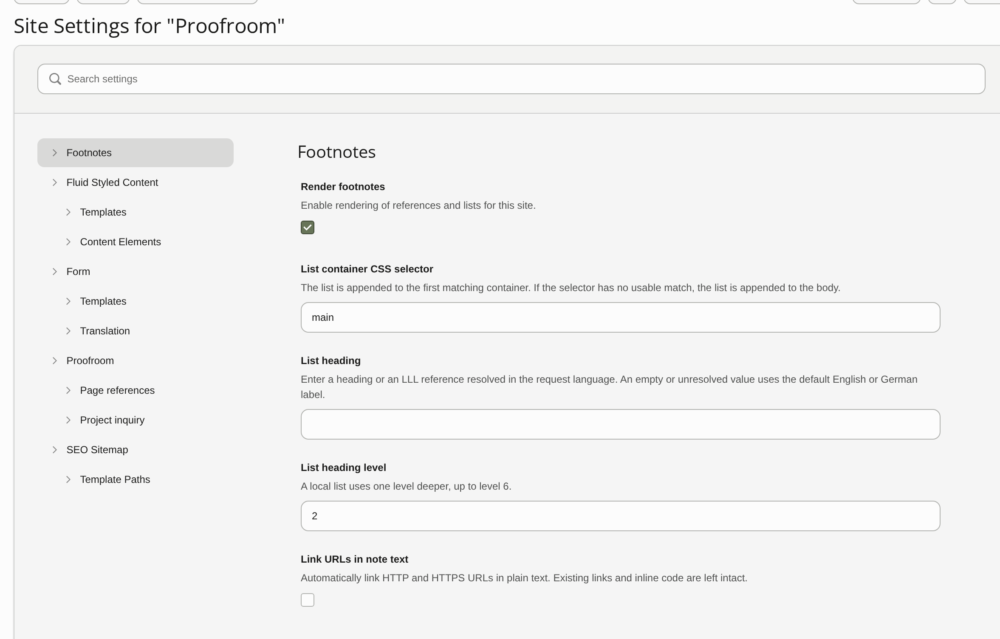

:navigation-title: Configuration

..  include:: /Includes.rst.txt

..  _site-settings:

=============
Configuration
=============

Change site settings in Site Management or in the site's ``settings.yaml``
using flat, dotted keys.

        selector, heading, heading level and automatic link switch.
    :width: 450px
    :align: center
    :class: with-shadow
    :zoom: lightbox

    The Footnotes category in the Site Management settings editor.

..  code-block:: yaml

    t3footnotes.enabled: true
    t3footnotes.selector: main
    t3footnotes.heading: ''
    t3footnotes.headingLevel: 2
    t3footnotes.autoLink: false

..  typo3:site-set-settings:: PROJECT:/Configuration/Sets/Footnotes/settings.definitions.yaml
    :name: t3footnotes-site-settings
    :type:
    :default:

..  _per-page-switch:

Per-page TypoScript switch
==========================

..  confval:: config.t3footnotesDisabled
    :type: boolean
    :default: 0

    Set this option to ``1`` to skip footnote rendering for the current page.
    The original page HTML passes through, including any stored markers.
    If the page contains stored notes, hide ``sup.t3foonote`` in your theme
    or omit the notes when rendering the page.

    Use a page condition to disable rendering for a single page.

    ..  code-block:: typoscript

        [page["uid"] == 42]
        config.t3footnotesDisabled = 1
        [end]
