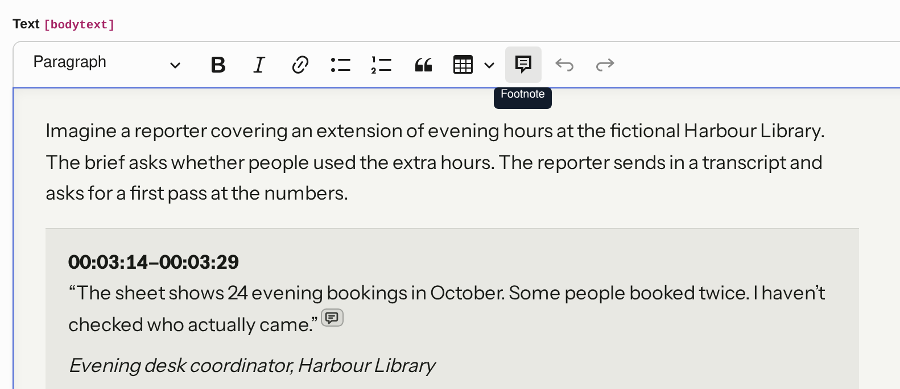
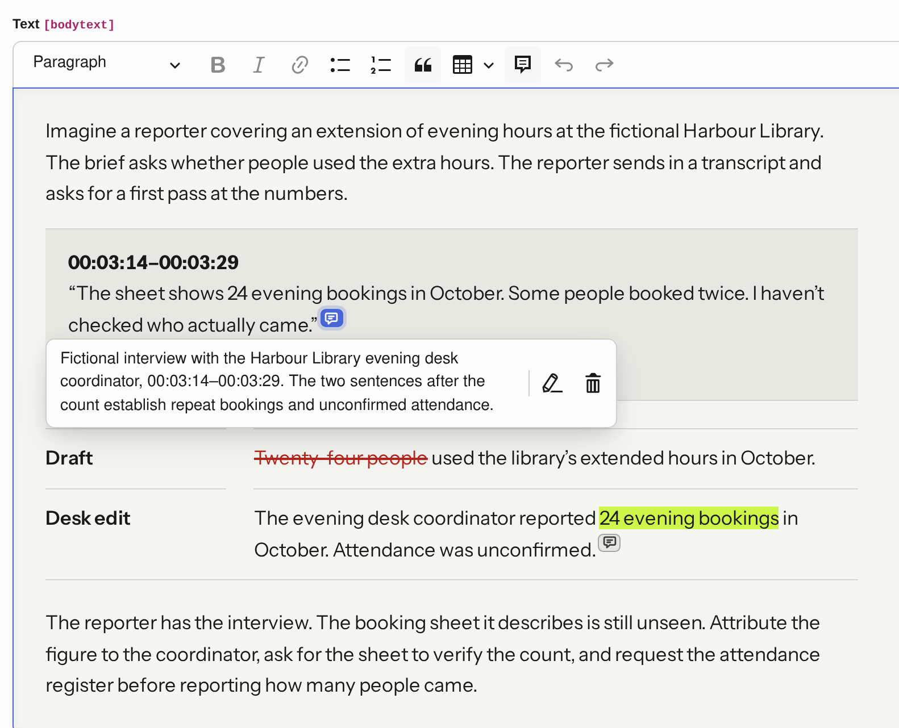
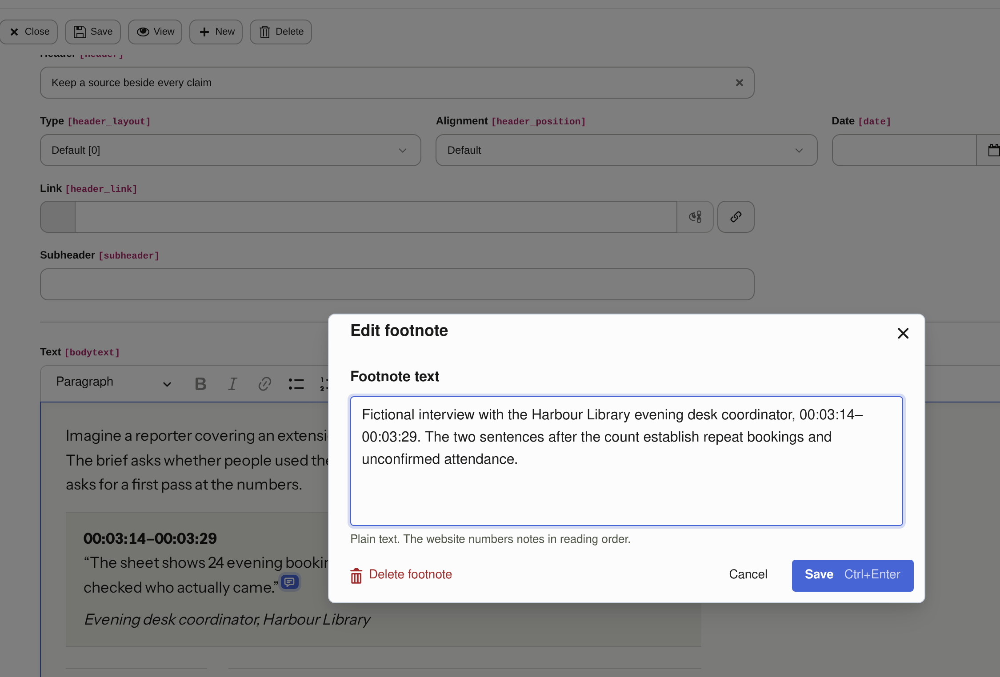

:navigation-title: Editor

..  include:: /Includes.rst.txt

..  _editor:

============
Editor guide
============

..  _add-footnote:

Add a footnote
==============

Place the caret directly after the word or sentence the note explains. Choose
:guilabel:`Footnote` in the toolbar, enter the note and choose
:guilabel:`Save`, or press :kbd:`Ctrl+Enter` (:kbd:`Cmd+Enter` on macOS). If
text is selected, the note is inserted at the selection's active end and the
selected text is preserved. The toolbar is also accessible with
:kbd:`Alt+F10` in CKEditor.

        right of the table button.
    :width: 450px
    :align: center
    :class: with-shadow
    :zoom: lightbox

    The speech-bubble button opens the footnote dialog.

In the editor, a footnote appears as a small raised speech-bubble marker after
the text. The website replaces it with the note number, counted in reading
order across the page.

..  _read-and-edit-footnote:

Read and edit a footnote
========================

Click a marker to select it. A small panel below the marker shows the note
text and buttons labeled :guilabel:`Edit footnote` and
:guilabel:`Delete footnote`. Pointing at a marker also shows the note text as
a tooltip. To place the caret next to a marker, click the text beside it or
use the arrow keys.

        labeled Edit footnote and Delete footnote.
    :width: 450px
    :align: center
    :class: with-shadow
    :zoom: lightbox

    One click selects the note and shows its text.

Double-click a marker, choose :guilabel:`Edit footnote` in the panel, or
select it and press :kbd:`Enter` to open the dialog. The text field grows with
the note. :kbd:`Enter` starts a new line, :kbd:`Ctrl+Enter` or
:kbd:`Cmd+Enter` saves, and :kbd:`Escape` or :guilabel:`Cancel` closes the
dialog without applying the edit. An empty note cannot be saved; the dialog
names the missing text under the field. After each action the caret returns to
the editor.

        numbering and the Delete footnote, Cancel and Save buttons.
    :width: 450px
    :align: center
    :class: with-shadow
    :zoom: lightbox

    The dialog keeps :guilabel:`Delete footnote` apart from :guilabel:`Cancel`
    and :guilabel:`Save`.

Delete a selected marker with :kbd:`Delete` or :kbd:`Backspace`, or choose
:guilabel:`Delete footnote` in the panel or the dialog. You can copy and paste
markers in CKEditor and use the editor's undo and redo commands.

..  _legacy-note-formatting:

Notes with formatting
=====================

The field accepts plain text. For a legacy note, it shows the text content
and a hint. Saving unchanged text keeps the original payload in CKEditor.
Saving different text replaces the payload with plain text, so typed tags
appear as literal text in the note.

TYPO3 applies the active rich-text preset when saving the record. In a
default TYPO3 14.3 RTE save, a legacy payload with emphasis, a safe link
and a nested image kept all three, and its span kept ``style="display: none"``.
Enabling TYPO3's ``security.backend.htmlSanitizeRte`` feature kept these safe
elements and attributes and removed an event handler. Custom presets can
remove images, styles or formatting. The frontend sanitizer separately filters
the stored payload. An image-only note may have an empty field in the dialog.

..  _legacy-notes-inside-links:

Legacy notes inside links
=========================

A legacy marker whose entire superscript is wrapped in another link needs a
source repair before opening the record in CKEditor. The HTML parser closes
the enclosing link at the note's inner anchor. CKEditor then saves an empty
widget, a separate placeholder link and the payload as ordinary text.
Move the whole superscript after the outer closing anchor in the stored HTML
before editing. The frontend can render the original linked marker and put
its numbered reference after the enclosing link.

Save the TYPO3 record to publish the edit according to its normal workflow.
The frontend numbers notes in page reading order.
