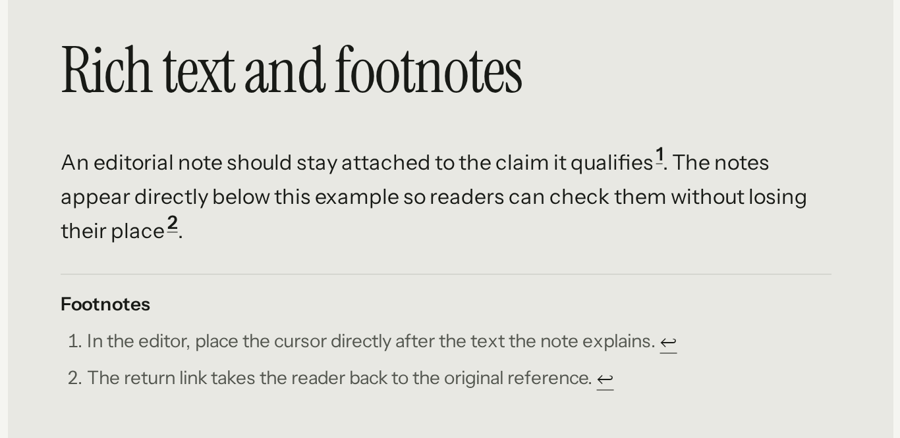

:navigation-title: Integration

..  include:: /Includes.rst.txt

..  _integrator:

================
Integrator guide
================

..  _rte-processing:

Rich-text processing
====================

See :ref:`installation-editor` for enabling the plugin.

Keep the standard TYPO3 RTE processing and sanitizer enabled. A custom
preset must preserve these elements and class tokens during RTE processing.

*   ``sup`` with ``class="t3foonote"``.
*   ``a`` with ``class="t3foonotes-anchor"``. Allow ``id`` and ``href`` if the
    preset retains the original fragment placeholders. The renderer generates
    the final IDs and links from the marker and payload.
*   ``span`` with ``class="t3foonotes-anchor-data"``. The editor emits an
    optional ``display: none`` style. The frontend renderer does not use that
    attribute to locate the payload.

To preserve legacy inline formatting, allow the relevant inline elements
and their safe attributes in the preset. For example, allow ``em`` and
``strong``, ``href`` on links, and ``src`` and ``alt`` on images. Test a
full record save after changing processing rules.

..  _placement:

Placement
=========

By default the list is appended inside the first matching container in the
body. Configure the selector in :ref:`site-settings`. Select a container
that accepts a section and has an explicit closing tag. A missing container
or an unsupported selector falls back to the body.

To position the list in your Fluid template, output this empty marker.

..  code-block:: html

    

The earliest explicit placement takes precedence over the selector. Use one
placement per page list. A standalone ``###FOOTNOTES###`` text marker also
takes a complete list. For the 1.x wrapper pattern, keep
``###FOOTNOTES_START###`` and ``###FOOTNOTES_END###`` around the wrapper and put
``###FOOTNOTES###`` inside its ordered list. The renderer preserves that wrapper
and inserts the list items. Empty placements are removed. Unmatched
delimiters are removed while their surrounding content is kept. Put marker
tokens in template text, outside attributes, comments and note payloads.

Use ``data-t3footnotes-local="richtext"`` on a wrapper to place a separate
list after each descendant ``.richtext`` block containing notes. All lists
share the page reading order. The explicit placement and selector apply to
notes outside the local blocks.

..  _markup-and-accessibility:

Markup and accessibility
========================

Style ``.t3footnote-ref``, ``.t3footnotes``, ``.t3footnotes__heading`` and
``.t3footnotes--local`` in the frontend theme. Pick a heading level that fits
the template hierarchy and preserve visible keyboard focus. Numbered links
have the ``doc-noteref`` role. Return links have the ``doc-backlink`` role.
Both have localized accessible names. The links and lists work without
frontend JavaScript.

        footnotes list with a return link beside each note.
    :width: 450px
    :align: center
    :class: with-shadow
    :zoom: lightbox

    The Proofroom component library shows references and return links.
    The demo site styles the list. The extension provides its markup.

..  code-block:: css

    .t3footnote-ref { margin-inline-start: .15em; }
    .t3footnotes { margin-block-start: 2rem; }
    .t3footnotes ol { list-style: decimal; padding-inline-start: 1.5em; }
    .t3footnote-ref a:focus-visible,
    .t3footnotes [role="doc-backlink"]:focus-visible {
        outline: 2px solid currentColor;
    }

The canonical stored marker is ``sup.t3foonote`` with a reference placeholder
and a direct child ``span.t3foonotes-anchor-data``. The class names
``t3foonote`` and ``t3foonotes-anchor`` are the historical 1.x spellings,
kept because they are in stored content. A blank or missing payload
removes its marker. Legacy inline formatting, safe links and images with
safe URLs can render. The HTML sanitizer preserves relative URLs and
HTTP or HTTPS URLs, plus mail and telephone links. TYPO3 record links
need to be resolved by the rich-text rendering pipeline first. A nested note
is discarded in full and the outer note retains its own content. Markers in
script, style, template, noscript and textarea are outside the reading order.

..  _caching-and-extension-event:

Caching and extension event
===========================

TYPO3 dispatches ``AfterCacheableContentIsGeneratedEvent`` before writing the
page cache. Cache hits serve the rendered notes. A full page built with
caching disabled is also processed at generation time. USER_INT and COA_INT
are expanded after that event. Keep notes and list markers in cacheable
content. Error responses produced by Fluid, PHP or other standalone 404
handlers bypass page generation. A 404 handler that renders a regular
TYPO3 page can use the footnotes already rendered on that page.

Listen for ``CAG\T3footnotes\Event\CollectedFootnotesEvent`` with a TYPO3
PSR-14 listener. ``getNotes()`` returns note objects in reading order. Each
object has a mutable ``content`` property containing inline HTML. Set it to
an empty string to remove the note and its reference. The renderer sanitizes
changes and then assigns numbers. The event exposes the frontend request
through ``getRequest()``. Use only inputs shared by requests for the same
page-cache variant.
