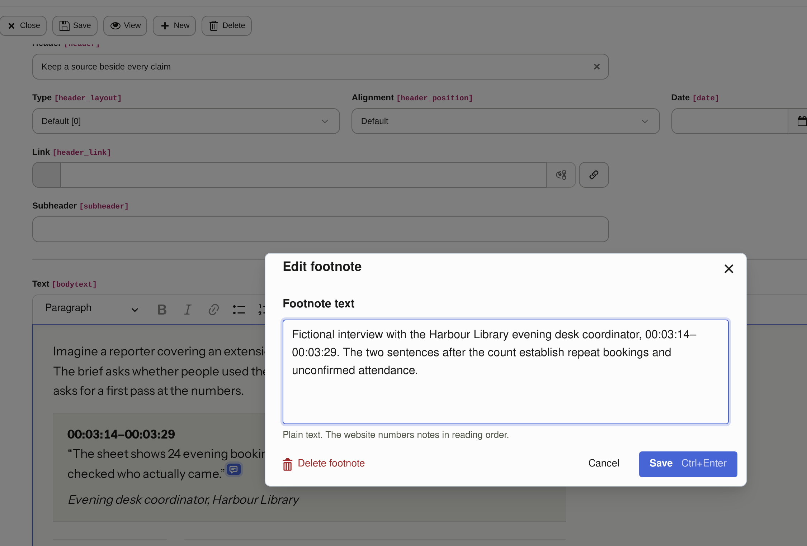

# Editorial footnotes for TYPO3

Add numbered footnotes to the TYPO3 rich text editor (RTE, CKEditor 5).
Editors place a note right where it belongs and write it in a dialog. On the
website, TYPO3 numbers the notes in reading order, lists them and links each
reference to its note and back.



## Features

- Dialog-based footnotes in the RTE (CKEditor 5), with a toolbar button and
  keyboard shortcuts
- Preview on click: one click on a note shows its text with Edit and Delete
- Cached rendering: notes are rendered once and stored in the page cache
- Accessible references and return links between the text and the note list
- Site settings for the list container, heading, heading level and linked
  URLs
- Notes written with 1.x keep their stored markup, no database conversion

## Requirements

- TYPO3 14.3
- PHP 8.4 or later

## Installation

- **Composer mode:** `composer require connecta-ag/t3footnotes`
- **Classic mode:** import and activate `t3footnotes` from the
  [TYPO3 Extension Repository (TER)](https://extensions.typo3.org/extension/t3footnotes)
  in the Extension Manager. On TYPO3 14.3.0 through 14.3.7, download the ZIP
  from TER and upload it manually

## Quick setup

1. Add the `connecta-ag/t3footnotes` site set to each site that should render
   notes
2. Import `EXT:t3footnotes/Configuration/RTE/Plugin.yaml` in the active RTE
   preset
3. Add the `t3footnote` item to the RTE toolbar and flush TYPO3's caches

## Links

- [Manual](https://docs.typo3.org/p/connecta-ag/t3footnotes/main/en-us/)
  (rendered after approval)
- [TER](https://extensions.typo3.org/extension/t3footnotes)
- [Packagist](https://packagist.org/packages/connecta-ag/t3footnotes)
- [Changelog](https://github.com/connecta-ag/t3footnotes/blob/main/CHANGELOG.md)
- [Upgrade guide from 1.x](https://github.com/connecta-ag/t3footnotes/blob/main/Documentation/Upgrade.rst)
- [Issues](https://github.com/connecta-ag/t3footnotes/issues)

## Contributing

In a source checkout, install dependencies with `composer update`. Run
`composer test:unit`, `composer test:functional`, `composer test:phpstan`
and `composer test:coding-standards`. The functional suite uses SQLite.

Render the manual from the extension root with the official TYPO3 image.

```sh
docker run --rm -v "$PWD:/project" \
  ghcr.io/typo3-documentation/render-guides:latest \
  --config=Documentation --no-progress --fail-on-log
```

Originally developed by Jochen Rieger. Maintained by [Connecta AG](https://www.connecta.ag/).
